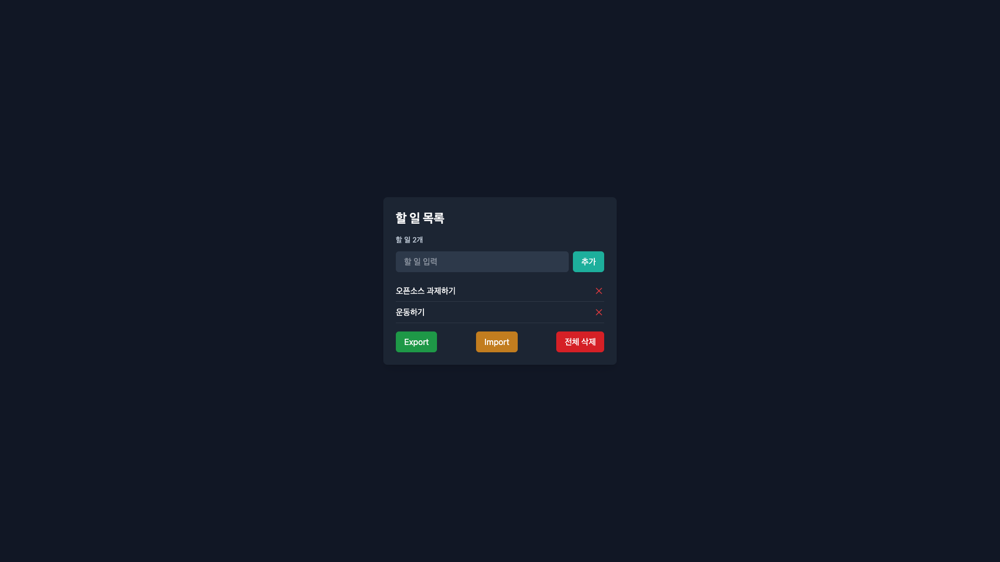

# 2026 OSS Assignment 10

## Project Information
이 프로젝트는 React로 만든 할 일 관리 앱이다.
코드가 짧아서 읽고 고치기 쉬워서 선택했다.

원본: https://github.com/VaibhavSys/react-todo-app
라이선스: MIT

## Installation
git clone https://github.com/donkeyears0402-star/2026-oss-assign10.git
cd 2026-oss-assign10
npm install
npm run dev

브라우저에서 http://localhost:5173 열면 된다.

## Source Code Exploration

주요 파일
- Home : 할 일 추가 삭제 저장하는 메인 화면
- Task : 할 일 한 줄이랑 삭제 버튼
- App : Home 연결하는 부분

컴포넌트
Home은 tasks 상태 관리하고 입력이랑 추가, 전체 삭제를 한다.
Task는 목록에서 한 항목이랑 삭제 버튼을 담당한다.

코드 분석
Home에 이런 코드가 있다.

useEffect(() => {
  localStorage.setItem("tasks", JSON.stringify(tasks));
}, [tasks]);

할 일 목록이 바뀌면 localStorage에 넣는 거다.
페이지 다시 열어도 전에 쓰던 할 일이 남아 있다.

## Customizing

Text 수정
Home이랑 index 고침
제목이 Todo App이었는데 할 일 목록으로 바꿈
Add 버튼도 추가로 바꿨고 입력창 안내 글자도 한글로 바꿈

Style 수정
Home에서 색 바꿈
추가 버튼을 파란색에서 청록색으로 바꿈
배경을 초록으로 한번 바꿨는데 너무 밝아서 그냥 다시 어둡게 했다

UI/Data 수정
Home
처음에 할 일이 비어있어서 예시로 두개 넣어봄
할 일 몇개인지 보이게 했고
추가 눌렀는데 입력창 글자가 안 지워져서 그것도 고침
할 일 없을 때 문구도 좀 넣음

## Deployment
GitHub: https://github.com/donkeyears0402-star/2026-oss-assign10
Vercel: https://2026-oss-assign10-six.vercel.app/

## Weekly Review

배운 내용
1. npm run dev로 실행해 두고 화면 보면서 고칠 수 있다
2. localStorage 쓰면 새로고침해도 할 일이 남는다
3. React에서는 Home, Task 같은 컴포넌트로 화면을 나눈다

어려웠던 점
디자인이 어려웠다. 배경색 바꿨더니 너무 밝아서 다시 어두운 색으로 맞췄다.

AI 활용
코드는 먼저 작성해 보고 위에서 아래 순서로 하나씩 공부했다.
12살에게 가르치듯 쉽게 설명해 달라고 해서 이해한 다음 직접 고치면서 배웠다.
